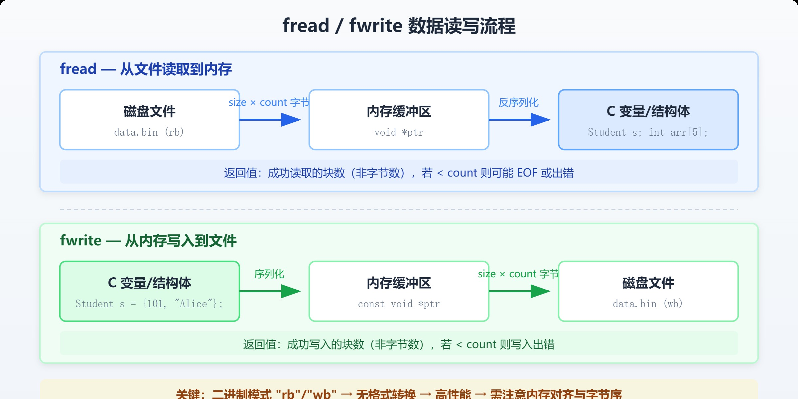
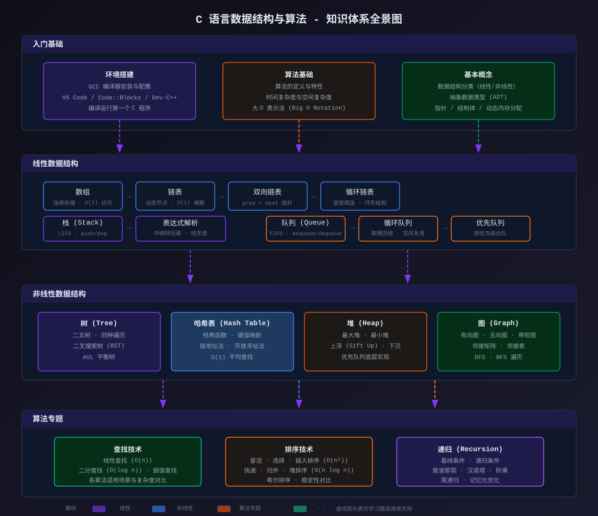

# 学习记录

学习路线：  
1、学习c语言	：
三大重点：指针本质学习--内存布局（栈/堆/全局）--结构体&位运算  
2、点灯工程师-学习stm32的内容，学习里面的详细内容  
3、学习并使用实时操作系统----rtos从freetos  
4、系统架构师--嵌入式Linux/FPGA  

## C语言学习[链接](https://www.runoob.com/)  
在线编辑公式--https://www.runoob.com/try/runcode.php?filename=helloworld&type=c  
首先学习c语言编程基础--(https://www.runoob.com/cprogramming/c-tutorial.html)  
在完成上述编程基础后开始对c语言数据结构的学习--(https://www.runoob.com/c-dsa/c-dsa-tutorial.html)  

### c语言基础编程
* 变量：

  | 类型 | 存储大小 | 值范围 |
  |---|---|---|
  | char | 1 字节 | -128 到 127 或 0 到 255 |
  | unsigned char | 1 字节 | 0 到 255 |
  | signed char | 1 字节 | -128 到 127 |
  | int | 2 或 4 字节 | -32,768 到 32,767 或 -2,147,483,648 到 2,147,483,647 |
  | unsigned int | 2 或 4 字节 | 0 到 65,535 或 0 到 4,294,967,295 |
  | short | 2 字节 | -32,768 到 32,767 |
  | unsigned short | 2 字节 | 0 到 65,535 |
  | long | 4 字节 | -2,147,483,648 到 2,147,483,647 |
  | unsigned long | 4 字节 | 0 到 4,294,967,295 |

* 宏定义: 宏在编译前由预处理器进行文本替换，不占用运行时内存。
* 函数声明: 在 C 语言中，函数的声明（也称原型）必须在**函数定义或调用之前**出现。声明提供了函数的返回类型、函数名和参数列表，以便编译器在调用点进行类型检查。  
* 变量声明：未初始化的局部变量包含不确定值（垃圾值），而**全局变量和静态变量**会被自动初始化为 0。
* 函数定义：C 语言的函数不支持重载，每个函数名在同一作用域中必须唯一。函数可以递归调用自身。
* 标识符：标识符由字母（大写或小写）、数字和下划线组成，但第一个字符必须是字母或下划线，不能是数字。C 标识符内不允许出现标点字符（可以是下划线）
* 字符串：  
    字符串字面量
    字符串字面量是由双引号括起来的字符序列，用于表示文本数据。
    
    字符串字面量在内存中以字符数组的形式存储，末尾会**自动添加一个空字符 \0（即 null 终止符）**，标志字符串的结束。
    
    char greeting[] = "Hello, World!";  // 编译器自动计算长度（包含 \0）
    以下是关于字符串字面量的几点重要说明：
    
    "Hello" 在内存中实际占 6 个字节：'H'、'e'、'l'、'l'、'o'、'\0'。
    字符串字面量存储在只读内存区域，不可修改；若需修改，应将其复制到字符数组中。

    两个相邻的字符串字面量会被编译器自动拼接："Hello, " "World!" 等同于 "Hello, World!"。
    字符 'A'（字符常量）和字符串 "A"（字符串字面量）是不同的，后者包含 'A' 和 '\0' 两个字符。

* 变量： C 语言中变量的默认值取决于其类型和作用域。全局变量和静态变量的默认值为 0，字符型变量的默认值为 \0，指针变量的默认值为 NULL，而局部变量没有默认值，其初始值是未定义的。
* c/c++中static的作用：
（1）在修饰变量的时候，static 修饰的静态局部变量只执行初始化一次，而且延长了局部变量的生命周期，直到程序运行结束以后才释放。
（2）static 修饰全局变量的时候，这个全局变量只能在本文件中访问，不能在其它文件中访问，即便是 extern 外部声明也不可以。
（3）static 修饰一个函数，则这个函数的只能在本文件中调用，不能被其他文件调用。static 修饰的变量存放在全局数据区的静态变量区，包括全局静态变量和局部静态变量，都在全局数据区分配内存。初始化的时候自动初始化为 0。
（4）不想被释放的时候，可以使用static修饰。比如修饰函数中存放在栈空间的数组。如果不想让这个数组在函数调用结束释放可以使用 static 修饰。
（5）考虑到数据安全性（当程序想要使用全局变量的时候应该先考虑使用 static）。

* 指针：C 指针数组是一个数组，其中的每个元素都是指向某种数据类型的指针。
* 函数指针：函数指针是指向函数的指针变量。
    
    通常我们说的指针变量是指向一个整型、字符型或数组等变量，而函数指针是指向函数。
    
    函数指针可以像一般函数一样，用于调用函数、传递参数。

    指向结构的指针：您可以定义指向结构的指针，方式与定义指向其他类型变量的指针相似，如下所示：

    struct Books *struct_pointer;
  
    现在，您可以在上述定义的指针变量中存储结构变量的地址。为了查找结构变量的地址，请把 & 运算符放在结构名称的前面，如下所示：

    struct_pointer = &Book1;
  
    为了使用指向该结构的指针访问结构的成员，您必须使用 -> 运算符，如下所示：

    struct_pointer->title;
* C 结构体：
truct 语句定义了一个包含多个成员的新的数据类型，struct 语句的格式如下：

            struct tag {
                member-list
                member-list
                member-list  
                ...
            } variable-list ;
    tag 是结构体标签。
    member-list 是标准的变量定义，比如 int i; 或者 float f;，或者其他有效的变量定义。
    variable-list 结构变量，定义在结构的末尾，最后一个分号之前，您可以指定一个或多个结构变量。
    在一般情况下，tag、member-list、variable-list 这 3 部分至少要出现 2 个。
    指向结构的指针：struct Books *struct_pointer;
    struct_pointer = &Book1;
    为了使用指向该结构的指针访问结构的成员，您必须使用 -> 运算符，如下所示：

    struct_pointer->title;
  **共用体**是一种特殊的数据类型，允许您在相同的内存位置存储不同的数据类型。您可以定义一个带有多成员的共用体，但是任何时候只能有一个成员带有值。共用体提供了一种使用相同的内存位置的有效方式。
* typedef vs #define：

    #define 是 C 指令，用于为各种数据类型定义别名，与 typedef 类似，但是它们有以下几点不同：
    
    typedef 仅限于为**类型定义符号名称**，#define 不仅可以为类型定义别名，也能为数值定义别名，比如您可以定义 1 为 ONE。
  
    typedef 是由编译器执行解释的，#define 语句是由预编译器进行处理的。
* C 输入 & 输出：
  printf() 函数用于将格式化的数据输出到标准输出设备
  scanf() 函数用于从标准输入设备（通常是键盘）读取格式化的输入
  常用格式控制符：

  | 格式符 | 含义 | 示例输出 |
  |---|---|---|
  | `%d` | 输出整数 | 10 |
  | `%f` | 输出浮点数 | 3.140000 |
  | `%.2f` | 保留两位小数 | 3.14 |
  | `%c` | 输出字符 | A |
  | `%s` | 输出字符串 | hello |

  **常用转义字符**

  | 转义字符 | 名称 | 作用 |
  |---|---|---|
  | `\b` | 退格符 | 将光标退回一个字符位置，不删除字符；后续输出可能覆盖该位置的字符。 |
  | `\r` | 回车符 | 将光标移至当前行的开头，不换行。 |
  | `\n` | 换行符 | 移至下一行的开头。 |
  | `\t` | 水平制表符 | 将光标移至下一个制表位置，常用于对齐。 |

  **常见错误与解决方法**

  | 错误 | 原因 | 解决方法 |
  |---|---|---|
  | 忘记加 `&` | `scanf` 无法通过变量的地址写入数据 | 读取普通变量时，在变量前加 `&` |
  | 格式符不匹配 | 类型与格式符不对应 | 对 `scanf`，`%d` 对应 `int`，`%f` 对应 `float`，`%lf` 对应 `double` |
  | 忘记 `#include <stdio.h>` | 输入输出函数缺少声明 | 在文件开头添加该头文件 |

* C文件读写：调用fopen( const char *filename, const char *mode );
  关闭 fclose( FILE *fp );写入fputc( int c, FILE *fp );
  
* C 可变参数：声明方式为：
    int func_name(int arg1, ...);
    其中，省略号 ... 表示可变参数列表。
    请注意，函数 func() 最后一个参数写成省略号，即三个点号（...），省略号之前的那个参数是 int，代表了要传递的可变参数的总数。

    需要使用 stdarg.h 头文件
* C内存管理：C 语言提供了一些函数和运算符，使得程序员可以对内存进行操作，包括分配、释放、移动和复制等。
  1	void *calloc(int num, int size);
  在内存中动态地分配 num 个长度为 size 的连续空间，并将每一个字节都初始化为 0。所以它的结果是分配了 num*size 个字节长度的内存空间，并且每个字节的值都是 0。
  2	void free(void *address);
  该函数释放 address 所指向的内存块,释放的是动态分配的内存空间。
  3	void *malloc(int num);
  在**堆区**分配一块指定大小的内存空间，用来存放数据。这块内存空间在函数执行完成后不会被初始化，它们的值是未知的。
  4	void *realloc(void *address, int newsize);
  该函数重新分配内存，把内存扩展到 newsize。
  注意：void * 类型表示未确定类型的指针。C、C++ 规定 void * 类型可以通过类型转换强制转换为任何其它类型的指针。

  **C 语言中常用的内存管理函数和运算符**
    * malloc() 函数：用于动态分配内存。它接受一个参数，即需要分配的内存大小（以字节为单位），并返回一个指向分配内存的指针。

    * free() 函数：用于释放先前分配的内存。它接受一个指向要释放内存的指针作为参数，并将该内存标记为未使用状态。

    * calloc() 函数：用于动态分配内存，并将其初始化为零。它接受两个参数，即需要分配的内存块数和每个内存块的大小（以字节为单位），并返回一个指向分配内存的指针。

    * realloc() 函数：用于重新分配内存。它接受两个参数，即一个先前分配的指针和一个新的内存大小，然后尝试重新调整先前分配的内存块的大小。如果调整成功，它将返回一个指向重新分配内存的指针，否则返回一个空指针。

    * sizeof 运算符：用于获取数据类型或变量的大小（以字节为单位）。

    * 指针运算符：用于获取指针所指向的内存地址或变量的值。

    * &运算符：用于获取变量的内存地址。

    * *运算符：用于获取指针所指向的变量的值。

    * -> 运算符：用于指针访问结构体成员，语法为 pointer->member，等价于 (*pointer).member。

    * memcpy() 函数：用于从源内存区域复制数据到目标内存区域。它接受三个参数，即目标内存区域的指针、源内存区域的指针和要复制的数据大小（以字节为单位）。

    * memmove() 函数：类似于 memcpy() 函数，但它可以处理重叠的内存区域。它接受三个参数，即目标内存区域的指针、源内存区域的指针和要复制的数据大小（以字节为单位）。
  
### C 语言数据结构与算法

* 通过 C 语言，学习者需要亲手管理内存、操作指针、构建结构体，这个过程能帮助我们真正理解：

  | 底层概念 | 通过 C 语言如何体现 |
  |---|---|
  | 内存布局 | 数组在内存中如何连续存放，通过指针运算直接访问 |
  | 动态内存 | 链表节点如何通过 `malloc` 动态分配并连接 |
  | 指针机制 | 树、图等复杂结构如何通过指针实现节点间的关联 |
  | 调用栈 | 递归调用通常如何借助调用栈实现，栈帧如何创建与销毁 |
* 算法基础
  * 伪代码（Pseudocode）
    伪代码使用接近自然语言、但具有一定结构化格式的文字来描述算法逻辑。
    它不依赖具体编程语言语法，便于快速表达思路。
  * 大 O 表示法
    大 O 表示法（Big O Notation）是衡量时间复杂度和空间复杂度最常用的数学工具。它描述的是算法在最坏情况下，随着输入规模 n 增大，运行时间或空间占用的增长趋势上界。

* 在学习数据结构之前，需要熟练掌握以下三个 C 语言核心知识点————指针、结构体、动态内存分配

* 数据结构 - 数组
  * 操作复杂度总结

    | 操作 | 时间复杂度 | 说明 |
    |---|---|---|
    | 索引访问 | O(1) | 直接计算地址 |
    | 末尾插入 | O(1) | 不需要移动元素 |
    | 头部/中间插入 | O(n) | 需要移动后续元素 |
    | 删除末尾元素 | O(1) | 不需要移动元素 |
    | 删除头部/中间元素 | O(n) | 需要移动后续元素 |
    | 线性查找 | O(n) | 逐个比较 |
    | 二分查找 | O(log n) | 要求数组已排序 |
* 数据结构 - 链表
  链表（Linked List）是一种由若干个节点通过指针依次连接而成的线性数据结构。与数组不同，链表中的元素在内存中并不要求连续存放。
