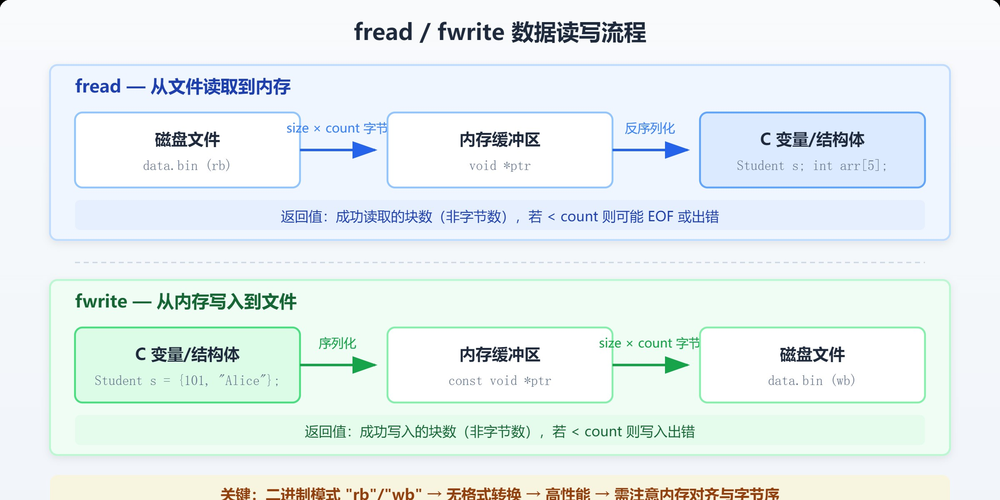
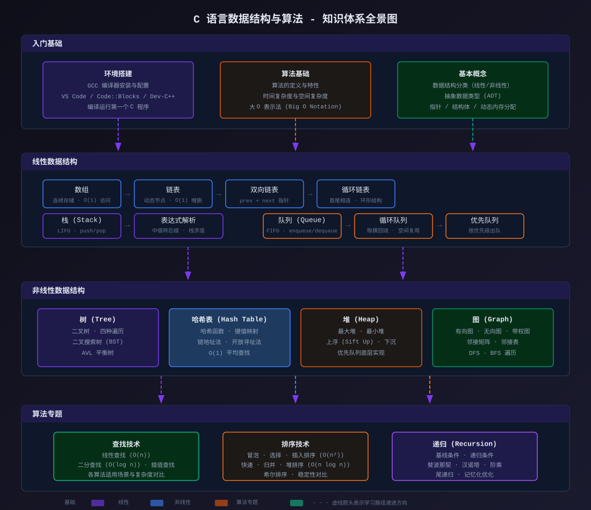
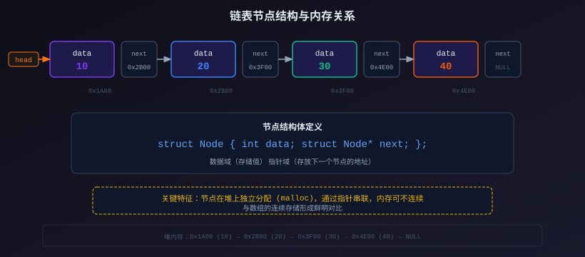
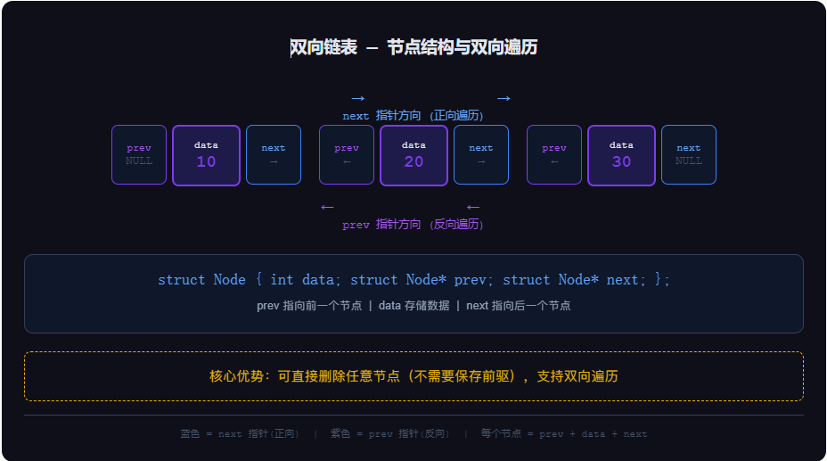
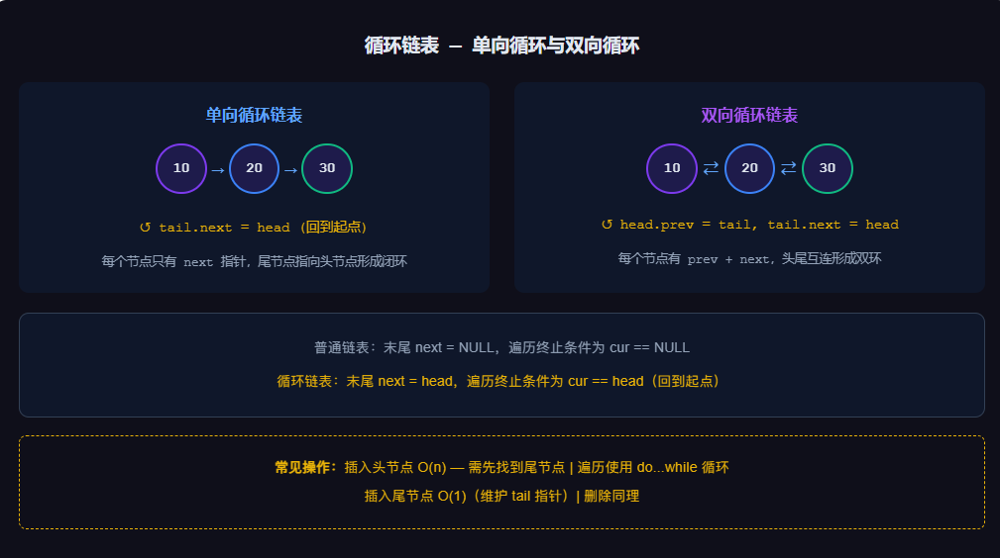
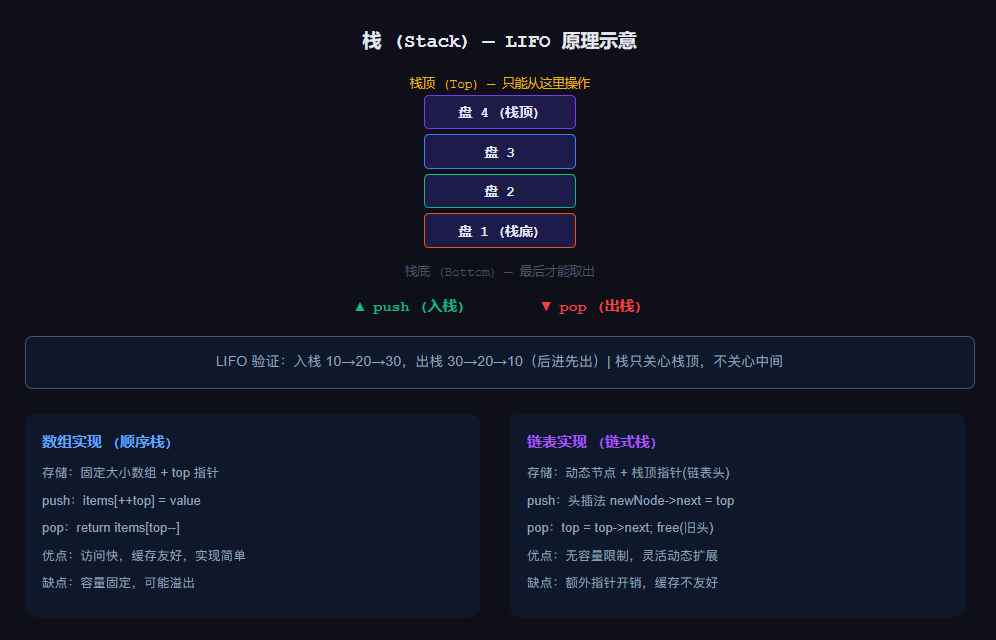
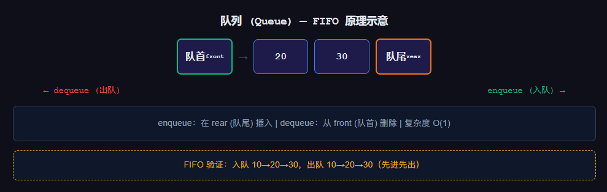
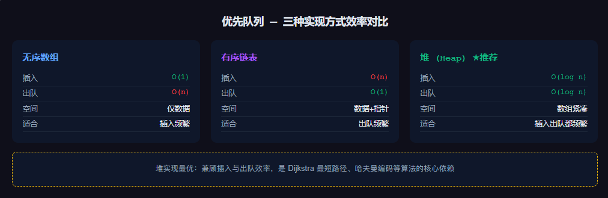
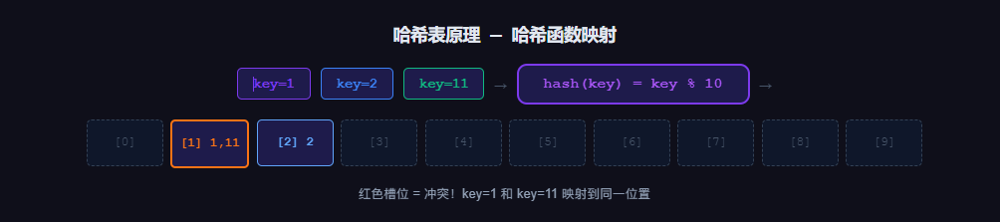
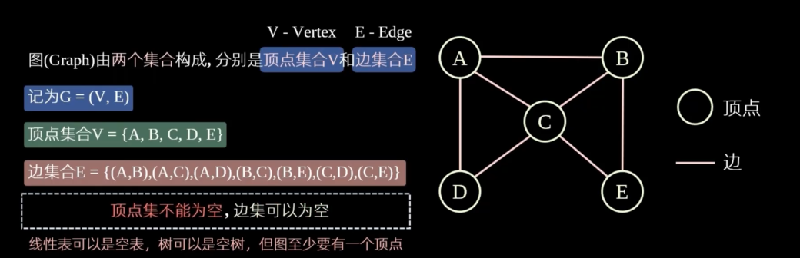

# 学习记录

学习路线：  
1、学习c语言	：
三大重点：指针本质学习--内存布局（栈/堆/全局）--结构体&位运算  
2、点灯工程师-学习stm32的内容，学习里面的详细内容  
3、学习并使用实时操作系统----rtos从freetos  
4、系统架构师--嵌入式Linux/FPGA  

## 目录

- [学习记录](#学习记录)
  - [目录](#目录)
  - [C语言学习链接](#c语言学习链接)
    - [c语言基础编程](#c语言基础编程)
      - [变量：](#变量)
      - [宏定义:](#宏定义)
      - [函数声明:](#函数声明)
      - [变量声明：](#变量声明)
      - [函数定义：](#函数定义)
      - [标识符：](#标识符)
      - [字符串：](#字符串)
      - [字符串数组的遍历：](#字符串数组的遍历)
      - [变量：](#变量-1)
      - [c/c++中static的作用：](#cc中static的作用)
      - [指针：](#指针)
      - [函数指针：](#函数指针)
      - [C 结构体：](#c-结构体)
      - [typedef vs #define：](#typedef-vs-define)
      - [C 输入 \& 输出：](#c-输入--输出)
      - [C文件读写：](#c文件读写)
      - [C 可变参数：](#c-可变参数)
      - [C 内存管理：](#c-内存管理)
      - [C 语言中常用的内存管理函数和运算符](#c-语言中常用的内存管理函数和运算符)
    - [C 语言数据结构与算法](#c-语言数据结构与算法)
      - [算法基础](#算法基础)
      - [数据结构 - 数组](#数据结构---数组)
      - [数据结构 - 链表](#数据结构---链表)
      - [数据结构 - 双向链表](#数据结构---双向链表)
      - [数据结构 - 循环链表](#数据结构---循环链表)
      - [数据结构 - 栈](#数据结构---栈)
      - [数据结构 - 表达式解析](#数据结构---表达式解析)
      - [数据结构 - 队列](#数据结构---队列)
      - [数据结构 - 优先队列](#数据结构---优先队列)
      - [数据结构 - 树](#数据结构---树)
      - [数据结构 - 哈希表](#数据结构---哈希表)
      - [数据结构 - 堆](#数据结构---堆)
      - [数据结构 - 图](#数据结构---图)
    - [ASCII 码表 0-127](#ascii-码表-0-127)

## C语言学习[链接](https://www.runoob.com/)  
首先学习c语言编程基础--(https://www.runoob.com/cprogramming/c-tutorial.html)  
在完成上述编程基础后开始对c语言数据结构的学习--(https://www.runoob.com/c-dsa/c-dsa-tutorial.html)  

### c语言基础编程
#### 变量：

  | 类型 | 存储大小 | 值范围 |
  |---|---|---|
  | char | 1 字节 | -128 到 127 或 0 到 255 |
  | unsigned char | 1 字节 | 0 到 255 |
  | signed char | 1 字节 | -128 到 127 |
  | int | 2 或 4 字节 | -32,768 到 32,767 或 -2,147,483,648 到 2,147,483,647 |
  | unsigned int | 2 或 4 字节 | 0 到 65,535 或 0 到 4,294,967,295 |
  | short | 2 字节 | -32,768 到 32,767 |
  | unsigned short | 2 字节 | 0 到 65,535 |
  | long | 4 字节 | -2,147,483,648 到 2,147,483,647 |
  | unsigned long | 4 字节 | 0 到 4,294,967,295 |

  负整数有多种二进制编码。 比如同一个 -5，用 8 位表示时有三种常见规则：

  | 编码 | -5 的位形 |	从 00000101（+5）怎么算 |
   |---|---|---|
  | 原码	| 10000101	| 把最高位改成 1，其余位保留 | 
  |反码	|11111010	| 把每一位取反 | 
  | 补码	| 11111011 | 	把每一位取反，再加 1 |
#### 宏定义:

    宏在编译前由预处理器进行文本替换，不占用运行时内存。
#### 函数声明:

    在 C 语言中，函数的声明（也称原型）必须在**函数定义或调用之前**出现。声明提供了函数的返回类型、函数名和参数列表，以便编译器在调用点进行类型检查。  
#### 变量声明：

    未初始化的局部变量包含不确定值（垃圾值），而**全局变量和静态变量**会被自动初始化为 0。
#### 函数定义：

    C 语言的函数不支持重载，每个函数名在同一作用域中必须唯一。函数可以递归调用自身。
#### 标识符：

    标识符由字母（大写或小写）、数字和下划线组成，但第一个字符必须是字母或下划线，不能是数字。C 标识符内不允许出现标点字符（可以是下划线）
#### 字符串：
    字符串字面量
    字符串字面量是由双引号括起来的字符序列，用于表示文本数据。
    
    字符串字面量在内存中以字符数组的形式存储，末尾会**自动添加一个空字符 \0（即 null 终止符）**，标志字符串的结束。
    
    char greeting[] = "Hello, World!";  // 编译器自动计算长度（包含 \0）
    以下是关于字符串字面量的几点重要说明：
    
    "Hello" 在内存中实际占 6 个字节：'H'、'e'、'l'、'l'、'o'、'\0'。
    字符串字面量存储在只读内存区域，不可修改；若需修改，应将其复制到字符数组中。

    两个相邻的字符串字面量会被编译器自动拼接："Hello, " "World!" 等同于 "Hello, World!"。
    字符 'A'（字符常量）和字符串 "A"（字符串字面量）是不同的，后者包含 'A' 和 '\0' 两个字符。
    
#### 字符串数组的遍历：

    这里有两层结构，外层是字符串数组，内层才是每条字符串。

    例如：

    ```c
    operations = {"--X", "X++", "X++"};
    ```

    可以理解为：

    ```text
    operations[0] -> ['-', '-', 'X', '\0']
    operations[1] -> ['X', '+', '+', '\0']
    operations[2] -> ['X', '+', '+', '\0']
    ```

    **每条字符串都有自己的 `\0`。**但外层有多少条字符串，由参数 `operationsSize` 告诉我们：

    ```c
    for (int i = 0; i < operationsSize; i++)
    ```

    - 遍历有多少条字符串：使用 `operationsSize`。
    - 遍历一条字符串中的字符：通常检查是否遇到 `\0`。
    - 这道题保证每条操作都是三个字符，我们只读取中间的字符：
    - 外层字符串数组不保证以空指针 `NULL` 结尾，所以要按给定的数量遍历。

#### 变量：

    C 语言中变量的默认值取决于其类型和作用域。全局变量和静态变量的默认值为 0，字符型变量的默认值为 \0，指针变量的默认值为 NULL，而局部变量没有默认值，其初始值是未定义的。
#### c/c++中static的作用：
    （1）在修饰变量的时候，static 修饰的静态局部变量只执行初始化一次，而且延长了局部变量的生命周期，直到程序运行结束以后才释放。
    （2）static 修饰全局变量的时候，这个全局变量只能在本文件中访问，不能在其它文件中访问，即便是 extern 外部声明也不可以。
    （3）static 修饰一个函数，则这个函数的只能在本文件中调用，不能被其他文件调用。static 修饰的变量存放在全局数据区的静态变量区，包括全局静态变量和局部静态变量，都在全局数据区分配内存。初始化的时候自动初始化为 0。
    （4）不想被释放的时候，可以使用static修饰。比如修饰函数中存放在栈空间的数组。如果不想让这个数组在函数调用结束释放可以使用 static 修饰。
    （5）考虑到数据安全性（当程序想要使用全局变量的时候应该先考虑使用 static）。

#### 指针：

    C 指针数组是一个数组，其中的每个元素都是指向某种数据类型的指针。
#### 函数指针：

    函数指针是指向函数的指针变量。
    
    通常我们说的指针变量是指向一个整型、字符型或数组等变量，而函数指针是指向函数。
    
    函数指针可以像一般函数一样，用于调用函数、传递参数。

    指向结构的指针：您可以定义指向结构的指针，方式与定义指向其他类型变量的指针相似，如下所示：

    struct Books *struct_pointer;
  
    现在，您可以在上述定义的指针变量中存储结构变量的地址。为了查找结构变量的地址，请把 & 运算符放在结构名称的前面，如下所示：

    struct_pointer = &Book1;
  
    为了使用指向该结构的指针访问结构的成员，您必须使用 -> 运算符，如下所示：

    struct_pointer->title;
#### C 结构体：
  truct 语句定义了一个包含多个成员的新的数据类型，struct 语句的格式如下：

            struct tag {
                member-list
                member-list
                member-list  
                ...
            } variable-list ;
    tag 是结构体标签。
    member-list 是标准的变量定义，比如 int i; 或者 float f;，或者其他有效的变量定义。
    variable-list 结构变量，定义在结构的末尾，最后一个分号之前，您可以指定一个或多个结构变量。
    在一般情况下，tag、member-list、variable-list 这 3 部分至少要出现 2 个。
    指向结构的指针：struct Books *struct_pointer;
    struct_pointer = &Book1;
    为了使用指向该结构的指针访问结构的成员，您必须使用 -> 运算符，如下所示：

    struct_pointer->title;
  **共用体**是一种特殊的数据类型，允许您在相同的内存位置存储不同的数据类型。您可以定义一个带有多成员的共用体，但是任何时候只能有一个成员带有值。共用体提供了一种使用相同的内存位置的有效方式。
#### typedef vs #define：

    #define 是 C 指令，用于为各种数据类型定义别名，与 typedef 类似，但是它们有以下几点不同：
    
    typedef 仅限于为**类型定义符号名称**，#define 不仅可以为类型定义别名，也能为数值定义别名，比如您可以定义 1 为 ONE。
  
    typedef 是由编译器执行解释的，#define 语句是由预编译器进行处理的。
#### C 输入 & 输出：
  printf() 函数用于将格式化的数据输出到标准输出设备
  scanf() 函数用于从标准输入设备（通常是键盘）读取格式化的输入
  常用格式控制符：

  | 格式符 | 含义 | 示例输出 |
  |---|---|---|
  | `%d` | 输出整数 | 10 |
  | `%f` | 输出浮点数 | 3.140000 |
  | `%.2f` | 保留两位小数 | 3.14 |
  | `%c` | 输出字符 | A |
  | `%s` | 输出字符串 | hello |

  **常用转义字符**

  | 转义字符 | 名称 | 作用 |
  |---|---|---|
  | `\b` | 退格符 | 将光标退回一个字符位置，不删除字符；后续输出可能覆盖该位置的字符。 |
  | `\r` | 回车符 | 将光标移至当前行的开头，不换行。 |
  | `\n` | 换行符 | 移至下一行的开头。 |
  | `\t` | 水平制表符 | 将光标移至下一个制表位置，常用于对齐。 |

  **常见错误与解决方法**

  | 错误 | 原因 | 解决方法 |
  |---|---|---|
  | 忘记加 `&` | `scanf` 无法通过变量的地址写入数据 | 读取普通变量时，在变量前加 `&` |
  | 格式符不匹配 | 类型与格式符不对应 | 对 `scanf`，`%d` 对应 `int`，`%f` 对应 `float`，`%lf` 对应 `double` |
  | 忘记 `#include <stdio.h>` | 输入输出函数缺少声明 | 在文件开头添加该头文件 |

#### C文件读写：

调用fopen( const char *filename, const char *mode );
  关闭 fclose( FILE *fp );写入fputc( int c, FILE *fp );
  
#### C 可变参数：

声明方式为：
    int func_name(int arg1, ...);
    其中，省略号 ... 表示可变参数列表。
    请注意，函数 func() 最后一个参数写成省略号，即三个点号（...），省略号之前的那个参数是 int，代表了要传递的可变参数的总数。

    需要使用 stdarg.h 头文件
#### C 内存管理：

C 语言提供了一些函数和运算符，使得程序员可以对内存进行操作，包括分配、释放、移动和复制等。
  1:	void *calloc(int num, int size);
  在内存中动态地分配 num 个长度为 size 的连续空间，并将每一个字节都初始化为 0。所以它的结果是分配了 num*size 个字节长度的内存空间，并且每个字节的值都是 0。
  2:	void free(void *address);
  该函数释放 address 所指向的内存块,释放的是动态分配的内存空间。
  3:	void *malloc(int num);
  在**堆区**分配一块指定大小的内存空间，用来存放数据。这块内存空间在函数执行完成后不会被初始化，它们的值是未知的。
  4:	void *realloc(void *address, int newsize);
  该函数重新分配内存，把内存扩展到 newsize。
  注意：void * 类型表示未确定类型的指针。C、C++ 规定 void * 类型可以通过类型转换强制转换为任何其它类型的指针。


#### C 语言中常用的内存管理函数和运算符
 * malloc() 函数：

用于动态分配内存。它接受一个参数，即需要分配的内存大小（以字节为单位），并返回一个指向分配内存的指针。

 * free() 函数：

用于释放先前分配的内存。它接受一个指向要释放内存的指针作为参数，并将该内存标记为未使用状态。

* calloc() 函数：

用于动态分配内存，并将其初始化为零。它接受两个参数，即需要分配的内存块数和每个内存块的大小（以字节为单位），并返回一个指向分配内存的指针。

* realloc() 函数：

用于重新分配内存。它接受两个参数，即一个先前分配的指针和一个新的内存大小，然后尝试重新调整先前分配的内存块的大小。如果调整成功，它将返回一个指向重新分配内存的指针，否则返回一个空指针。

* sizeof 运算符：

用于获取数据类型或变量的大小（以字节为单位）。

* 指针运算符：

用于获取指针所指向的内存地址或变量的值。

<a id="address-operator"></a>

* & 运算符：

用于获取变量的内存地址。

<a id="dereference-operator"></a>

 * 运算符：

用于获取指针所指向的变量的值。

<a id="member-access-operator"></a>

* ->  运算符：

用于指针访问结构体成员，语法为 pointer->member，等价于 (*pointer).member。

* memcpy() 函数：

用于从源内存区域复制数据到目标内存区域。它接受三个参数，即目标内存区域的指针、源内存区域的指针和要复制的数据大小（以字节为单位）。

* memmove() 函数：

类似于 memcpy() 函数，但它可以处理重叠的内存区域。它接受三个参数，即目标内存区域的指针、源内存区域的 逻辑运算符：

假设变量 `A` 的值为 `1`，变量 `B` 的值为 `0`。

      | 运算符 | 描述 | 实例 |
      |---|---|---|
      | `&&` | 逻辑与运算符。两个操作数都非零时，条件为真。 | `(A && B)` 为假。 |
      | `||` | 逻辑或运算符。至少一个操作数非零时，条件为真。 | `(A || B)` 为真。 |
      | `!` | 逻辑非运算符。逆转操作数的逻辑状态，真变假，假变真。 | `!(A && B)` 为真。 |
* C语言自增(++)/自减(--)运算符：
      **前缀形式 (++x, --x) 的执行逻辑**
      前缀形式，即运算符位于操作数之前（如 ++x ）。它的执行逻辑分为两步，且顺序固定：

      1 先自增/自减 ：首先，操作数 x 的值立即被加 1（或减 1）。
      2 后取值 ：然后，将 x 自增/自减后的新值，作为整个表达式 ++x （或 --x ）的值。
 
      **后缀形式 (x++, x--) 的执行逻辑**
      后缀形式，即运算符位于操作数之后（如 x++ ）。它的执行逻辑同样分为两步，但顺序与前缀相反：

      1 先取值 ：首先，将操作数 x 的当前值（未改变的原值），作为整个表达式 x++ （或 x-- ）的值。
      2 后自增/自减 ：然后，操作数 x 的值被加 1（或减 1）。
      核心差异：
      | 特性 | 前缀形式（`++x` / `--x`） | 后缀形式（`x++` / `x--`） |
      |---|---|---|
      | 操作数变化时机 | 先更新操作数，再得到表达式的值 | 先得到操作数的旧值，再更新操作数 |
      | 表达式的值 | 操作数变化后的新值 | 操作数变化前的旧值 |
      | 记忆口诀 | 先变后用 | 先用后变 |
      | 典型使用场景 | 需要使用新值时，如循环条件、数组索引计算 | 需要使用原值，同时更新变量时，如数组遍历后移指针 |
* 位运算符

下表显示了 C 语言支持的位运算符。假设 `A = 60`（二进制 `0011 1100`），`B = 13`（二进制 `0000 1101`）。

| 运算符 | 描述 | 实例 |
|---|---|---|
| `&` | 对两个操作数的每一位执行按位与：对应位都为 1 时结果为 1，否则为 0。规则：`0&0=0`、`0&1=0`、`1&0=0`、`1&1=1`。 | `A & B = 12`，二进制为 `0000 1100` |
| `\|` | 对两个操作数的每一位执行按位或：对应位都为 0 时结果为 0，否则为 1。规则：`0\|0=0`、`0\|1=1`、`1\|0=1`、`1\|1=1`。 | `A \| B = 61`，二进制为 `0011 1101` |
| `^` | 对两个操作数的每一位执行按位异或：对应位相同时结果为 0，不同时为 1。规则：`0^0=0`、`0^1=1`、`1^0=1`、`1^1=0`。 | `A ^ B = 49`，二进制为 `0011 0001` |
| `~` | 按位取反，将每一位的 0 变为 1、1 变为 0。 | 在常见补码表示中，`~A = -61`；低 8 位为 `1100 0011`。 |
| `<<` | 左移指定的位数，左侧移出的位丢弃，右侧补 0。 | `A << 2 = 240`，二进制为 `1111 0000` |
| `>>` | 右移指定的位数，右侧移出的位丢弃；非负整数左侧补 0。 | `A >> 2 = 15`，二进制为 `0000 1111` |

按位取反作用于整个整数。在常见补码表示中，`~1 = -2`，`~0 = -1`。移位数必须非负且小于左操作数经整数提升后的位宽。有符号负数的左移，以及有符号非负数左移后结果不可表示的情况，行为未定义；有符号负数的右移结果由实现定义。

* C 运算符优先级（由高到低）

| 优先级 | 运算符 | 说明 | 结合性 |
|---:|---|---|---|
| 1 | `()` `[]` `->` `.` `expr++` `expr--` | 函数调用、下标、成员访问、后缀自增/自减 | 从左到右 |
| 2 | `++expr` `--expr` `+` `-` `!` `~` `*` `&` `sizeof` `_Alignof` `(type)` | 前缀自增/自减、正负号、逻辑非、按位取反、解引用、取地址、大小/对齐、强制类型转换 | 从右到左 |
| 3 | `*` `/` `%` | 乘、除、取余 | 从左到右 |
| 4 | `+` `-` | 加、减 | 从左到右 |
| 5 | `<<` `>>` | 左移、右移 | 从左到右 |
| 6 | `<` `<=` `>` `>=` | 关系比较 | 从左到右 |
| 7 | `==` `!=` | 相等、不等比较 | 从左到右 |
| 8 | `&` | 按位与 | 从左到右 |
| 9 | `^` | 按位异或 | 从左到右 |
| 10 | `\|` | 按位或 | 从左到右 |
| 11 | `&&` | 逻辑与 | 从左到右 |
| 12 | `\|\|` | 逻辑或 | 从左到右 |
| 13 | `?:` | 条件运算符 | 从右到左 |
| 14 | `=` `+=` `-=` `*=` `/=` `%=` `<<=` `>>=` `&=` `^=` `\|=` | 赋值及复合赋值 | 从右到左 |
| 15 | `,` | 逗号运算符 | 从左到右 |

表中优先级从上到下递减。优先级决定表达式的分组，结合性决定同一优先级连续出现时的分组方式；需要时可用括号明确意图。优先级不等同于求值顺序，C 语言中部分操作数的求值顺序未指定。

### C 语言数据结构与算法



* 通过 C 语言，学习者需要亲手管理内存、操作指针、构建结构体，这个过程能帮助我们真正理解：

  | 底层概念 | 通过 C 语言如何体现 |
  |---|---|
  | 内存布局 | 数组在内存中如何连续存放，通过指针运算直接访问 |
  | 动态内存 | 链表节点如何通过 `malloc` 动态分配并连接 |
  | 指针机制 | 树、图等复杂结构如何通过指针实现节点间的关联 |
  | 调用栈 | 递归调用通常如何借助调用栈实现，栈帧如何创建与销毁 |
#### 算法基础
  **伪代码（Pseudocode）**
    伪代码使用接近自然语言、但具有一定结构化格式的文字来描述算法逻辑。
    它不依赖具体编程语言语法，便于快速表达思路。
  **大 O 表示法**
    大 O 表示法（Big O Notation）是衡量时间复杂度和空间复杂度最常用的数学工具。它描述的是算法在最坏情况下，随着输入规模 n 增大，运行时间或空间占用的增长趋势上界。

* 在学习数据结构之前，需要熟练掌握以下三个 C 语言核心知识点————指针、结构体、动态内存分配

#### 数据结构 - 数组
  **操作复杂度总结**

    | 操作 | 时间复杂度 | 说明 |
    |---|---|---|
    | 索引访问 | O(1) | 直接计算地址 |
    | 末尾插入 | O(1) | 不需要移动元素 |
    | 头部/中间插入 | O(n) | 需要移动后续元素 |
    | 删除末尾元素 | O(1) | 不需要移动元素 |
    | 删除头部/中间元素 | O(n) | 需要移动后续元素 |
    | 线性查找 | O(n) | 逐个比较 |
    | 二分查找 | O(log n) | 要求数组已排序 |
#### 数据结构 - 链表
  链表（Linked List）是一种由若干个节点通过指针依次连接而成的线性数据结构。与数组不同，链表中的元素在内存中并不要求连续存放。
  
  /* 链表节点结构体
   data：数据域，存储整型数据
   next：指针域，指向下一个同类型节点 */

  struct Node {

      int data;

      struct Node* next;
  };
#### 数据结构 - 双向链表
  双向链表（Doubly Linked List）是对单链表的扩展，每个节点除了指向下一个节点之外，还额外保存一个指向前一个节点的指针，从而形成双向可达的链式结构。

  struct Node {

      int data;              /* 数据域 */
      struct Node* prev;     /* 前驱指针：指向前一个节点 */
      struct Node* next;     /* 后继指针：指向后一个节点 */

  };
#### 数据结构 - 循环链表
  循环链表是链表结构的一种变体，其核心特点是链表的最后一个节点不再指向 NULL，而是重新指向第一个节点，从而使整个链表在逻辑上形成一个环状结构。

循环链表主要分为两种类型：

  **单向循环链表**：每个节点只保存一个 next 指针，最后一个节点的 next 重新指向头节点
  **双向循环链表**：在双向链表的基础上，最后一个节点的 next 指向头节点，头节点的 prev 指向最后一个节点
  循环链表结构最大的特点在于它天然支持首尾相接的连续遍历。
  判断遍历结束的条件不是"是否到达 NULL"，而是"是否回到了起始节点"。
#### 数据结构 - 栈
  栈（Stack）是一种遵循后进先出（Last In First Out，LIFO）原则的线性数据结构，可以形象地理解为一摞叠放的盘子——只能从最上面放入，也只能从最上面取走。
  
#### 数据结构 - 表达式解析
  表达式解析（Parsing Expressions）是栈这一数据结构最经典的应用场景。
  表达式解析展示了如何利用栈来处理中缀、前缀和后缀表达式之间的转换以及表达式求值。
  在计算机中处理数学表达式时，有三种表示方式：

  | 类型 | 运算符位置 | 示例 | 求值难度 | 括号需求 |
  |---|---|---|---|---|
  | 中缀表达式 | 操作数之间（人习惯） | `A + B * C` | 需要处理优先级和括号 | 需要时使用 |
  | 前缀表达式（波兰式） | 操作数之前 | `+ A * B C` | 扫描一遍即可 | 不需要 |
  | 后缀表达式（逆波兰式） | 操作数之后 | `A B C * +` | 扫描一遍即可 | 不需要 |

  前缀和后缀表达式的优势是求值时不需要考虑运算符优先级和括号。通常使用栈求值：前缀表达式从右向左扫描，后缀表达式从左向右扫描。
  前缀表达式计算时，从后往前，后入栈的先算
  后缀表达式计算时，从前往后，先入栈的先算
#### 数据结构 - 队列
  队列（Queue）是一种遵循先进先出（First In First Out，FIFO）原则的线性数据结构，可以类比为现实生活中排队买票的场景——最先排队的人最先获得服务。
  
  队列只允许在一端（队尾）进行插入操作，在另一端（队首）进行删除操作。
#### 数据结构 - 优先队列
  优先队列（Priority Queue）是队列的一种扩展形式，与普通队列的"先进先出"不同，优先队列中的每个元素都被赋予一个优先级，出队操作总是取出当前队列中优先级最高的元素。
  三种实现方式对比：
  
#### 数据结构 - 树
  树（Tree）是一种典型的非线性数据结构，由节点和连接节点的边构成，用于表示元素之间"一对多"的层级关系。


  常见的四种遍历方式如下：

  | 遍历方式 | 访问顺序 | 典型应用 |
  |---|---|---|
  | 前序遍历 | 根 → 左 → 右 | 复制树、前缀表达式生成 |
  | 中序遍历 | 左 → 根 → 右 | BST 输出有序序列 |
  | 后序遍历 | 左 → 右 → 根 | 删除树、后缀表达式生成 |
  | 层序遍历 | 逐层从左到右 | BFS、按层打印 |
#### 数据结构 - 哈希表
  哈希表（Hash Table）是一种通过哈希函数将键映射到数组中特定位置，从而实现平均 O(1) 时间复杂度查找、插入和删除操作的数据结构。
  哈希函数与哈希冲突：
  
  **哈希函数**的设计目标是将任意输入（键）转换为一个固定范围内的整数（数组下标）。

  一个好的哈希函数应具备计算速度快、结果分布均匀的特点。

  然而，由于哈希表的容量总是有限的，**哈希冲突**——两个不同的键被映射到同一位置——是不可避免的现象。
  冲突解决方法：

  | 方法 | 原理 | 优点 | 缺点 |
  |---|---|---|---|
  | 链地址法 | 每个槽位存一个链表，冲突的键追加到链表中 | 实现简单、删除方便、负载因子可大于 1 | 额外指针开销、缓存不友好 |
  | 开放寻址法 | 冲突时按探测规则在数组中寻找下一个空位 | 无需指针，缓存友好 | 删除复杂（需惰性删除）、负载因子需控制 |
  
  
#### 数据结构 - 堆
  堆（Heap）是一种特殊的完全二叉树结构，满足堆序性质。堆只保证父子节点之间的大小关系，不要求左右子树之间存在严格的顺序。
  数组按树的层次，从上到下、从左到右存储节点：

  ```text
              arr[0]
             /      \
         arr[1]    arr[2]
         /   \      /   \
     arr[3] arr[4] arr[5] arr[6]
  ```

  堆的两种类型：

  - 最大堆（Max Heap）：每个父节点 ≥ 子节点，根节点为最大值。
  - 最小堆（Min Heap）：每个父节点 ≤ 子节点，根节点为最小值。

  由于堆是完全二叉树，天然适合用数组存储。对于索引从 0 开始的节点，关系如下：

  | 节点关系 | 位置 |
  |---|---|
  | 父节点 parent(i) | `⌊(i - 1) / 2⌋`（`i > 0`） |
  | 左子节点 left(i) | `2 * i + 1` |
  | 右子节点 right(i) | `2 * i + 2` |
#### 数据结构 - 图
  图（Graph）是一种更为通用的非线性数据结构，用于表示元素之间"多对多"的复杂关系，由顶点和连接顶点的边构成。
  


### ASCII 码表 0-127

  | ASCII值 | 控制字符 | ASCII值 | 控制字符 | ASCII值 | 控制字符 | ASCII值 | 控制字符 |
  |---:|---|---:|---|---:|---|---:|---|
  | 0 | NUL | 32 | (space) | 64 | @ | 96 | ` |
  | 1 | SOH | 33 | ! | 65 | A | 97 | a |
  | 2 | STX | 34 | " | 66 | B | 98 | b |
  | 3 | ETX | 35 | # | 67 | C | 99 | c |
  | 4 | EOT | 36 | $ | 68 | D | 100 | d |
  | 5 | ENQ | 37 | % | 69 | E | 101 | e |
  | 6 | ACK | 38 | & | 70 | F | 102 | f |
  | 7 | BEL | 39 | ' | 71 | G | 103 | g |
  | 8 | BS | 40 | ( | 72 | H | 104 | h |
  | 9 | HT | 41 | ) | 73 | I | 105 | i |
  | 10 | LF | 42 | * | 74 | J | 106 | j |
  | 11 | VT | 43 | + | 75 | K | 107 | k |
  | 12 | FF | 44 | , | 76 | L | 108 | l |
  | 13 | CR | 45 | - | 77 | M | 109 | m |
  | 14 | SO | 46 | . | 78 | N | 110 | n |
  | 15 | SI | 47 | / | 79 | O | 111 | o |
  | 16 | DLE | 48 | 0 | 80 | P | 112 | p |
  | 17 | DC1 | 49 | 1 | 81 | Q | 113 | q |
  | 18 | DC2 | 50 | 2 | 82 | R | 114 | r |
  | 19 | DC3 | 51 | 3 | 83 | S | 115 | s |
  | 20 | DC4 | 52 | 4 | 84 | T | 116 | t |
  | 21 | NAK | 53 | 5 | 85 | U | 117 | u |
  | 22 | SYN | 54 | 6 | 86 | V | 118 | v |
  | 23 | ETB | 55 | 7 | 87 | W | 119 | w |
  | 24 | CAN | 56 | 8 | 88 | X | 120 | x |
  | 25 | EM | 57 | 9 | 89 | Y | 121 | y |
  | 26 | SUB | 58 | : | 90 | Z | 122 | z |
  | 27 | ESC | 59 | ; | 91 | [ | 123 | { |
  | 28 | FS | 60 | < | 92 | \\ | 124 | \| |
  | 29 | GS | 61 | = | 93 | ] | 125 | } |
  | 30 | RS | 62 | > | 94 | ^ | 126 | ~ |
  | 31 | US | 63 | ? | 95 | _ | 127 | DEL |
  